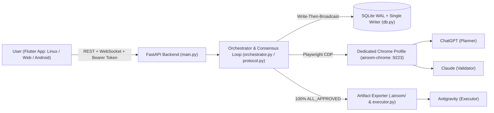

# AIroom — Multi-Agent Consensus Orchestrator

**AIroom** is a cross-platform application (Flutter + Python FastAPI) that coordinates **ChatGPT** (Planner), **Claude** (Validator/Auditor), and **Antigravity** (Executor) through a dedicated Chrome DevTools Protocol (CDP) browser session.

**الفكرة باختصار**: أنت تطلب المشروع، و**ChatGPT** يضع الخطة بعلامات اتفاق، و**Claude** يدققها ويصادق عليها (مع جولات تعديل تلقائية حتى الإجماع 100%)، ثم يسلّم **AIroom** الخطة المعتمدة جاهزة إلى **Antigravity** للتنفيذ فقط.

---

## Architecture



---

## Key Features

- **Consensus-Gated Execution**: Execution handoff (`POST /api/sessions/{id}/execute`) is blocked (`409`) until all plan items reach `APPROVED`.
- **Free-Tier Friendly**: Detects quota/rate-limit banners, saves `resume_step` in SQLite, clicks *Continue generating* automatically, compacts relay text (`compact_relay_text()`), and conducts model-to-model negotiation in concise technical English.
- **Persistent SQLite + WebSocket Replay**: WAL mode, single-writer queue, `seq`-ordered messages, and race-free `?last_seq=N` WebSocket reconnection.
- **Dedicated Browser Isolation**: Uses a dedicated `--user-data-dir` (`AIROOM_CHROME_DIR`) on port `9223` so your personal browser profile stays untouched.
- **Security**: Auto-generated `0600` bearer API token, localhost-by-default binding (`127.0.0.1`), path-traversal protection on `.airoom/` reads, and secret redaction in execution logs.

---

## Quickstart

### 1. Backend Setup
```bash
cd backend
python3 -m venv .venv
.venv/bin/pip install -r requirements-dev.txt
.venv/bin/uvicorn main:app --host 127.0.0.1 --port 8765
```

### 2. Launch Flutter App
```bash
cd app
flutter pub get
flutter run -d linux
```
Or run both together on Linux:
```bash
./start_airoom.sh
```

For **Flutter Web**, pass the backend URL at build/run time (never embed tokens in web builds):
```bash
flutter build web --dart-define=AIROOM_API_URL=http://127.0.0.1:8765
```

---

## Configuration (Environment Variables)

See [.env.example](.env.example). All paths default to XDG / local user directories:

| Variable | Default | Purpose |
|---|---|---|
| `AIROOM_HOST` | `127.0.0.1` | FastAPI bind host |
| `AIROOM_PORT` | `8765` | FastAPI port |
| `AIROOM_CDP_URL` | `http://127.0.0.1:9223` | Dedicated Chrome CDP endpoint |
| `AIROOM_DATA_DIR` | `./backend/data` or `$XDG_DATA_HOME/airoom` | SQLite DB & token directory |
| `AIROOM_DB_PATH` | `$AIROOM_DATA_DIR/airoom.db` | SQLite database file |
| `AIROOM_TOKEN_PATH` | `$AIROOM_DATA_DIR/api_token` | Bearer API token (`0600`) |
| `AIROOM_CHROME_DIR` | `~/.config/airoom-chrome` | Dedicated Chrome profile |
| `AIROOM_CORS_ORIGINS` | `http://localhost,http://127.0.0.1` | Allowed CORS origins (`*` rejected) |

---

## Verification & Tests

Run the full validation gate:
```bash
./scripts/validate_release.sh
```
Measured baseline:
- **Backend (`pytest -v`)**: 19 hermetic tests passing (`test_db_p1.py`, `test_auth_p2.py`, `test_config_p3.py`, `test_p3_p5.py`, `test_protocol.py`).
- **Frontend**: `flutter analyze` (0 issues) and `flutter test` (1/1 passing).

---

## Security & Third-Party Disclaimer

- See [SECURITY.md](SECURITY.md) for the local threat model and vulnerability reporting.
- **Third-Party Web UIs**: AIroom automates user-owned browser sessions (`chatgpt.com`, `claude.ai`) via Playwright CDP rather than official APIs. UI changes may affect automation, and users are responsible for complying with applicable Terms of Service.
- **No Affiliation**: AIroom is an independent open-source project and is not affiliated with or endorsed by OpenAI, Anthropic, or Google.

## License

[MIT](LICENSE) • [Contributing](CONTRIBUTING.md) • [Changelog](CHANGELOG.md)
